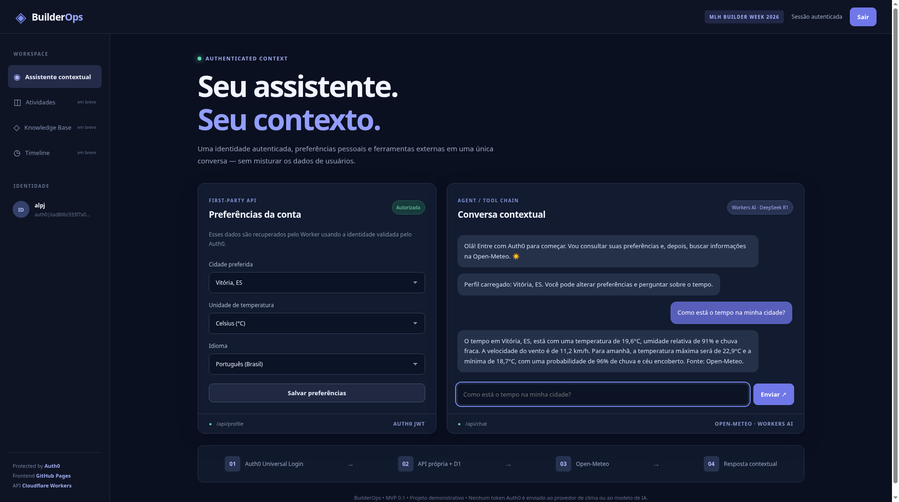
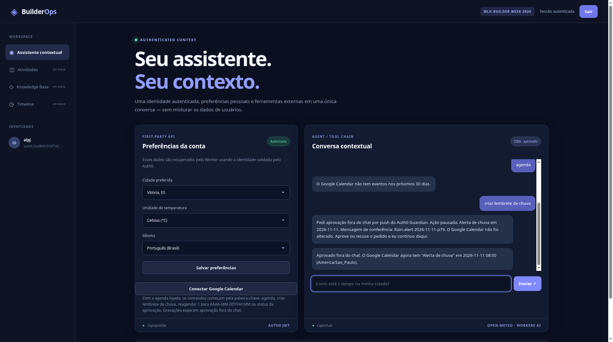
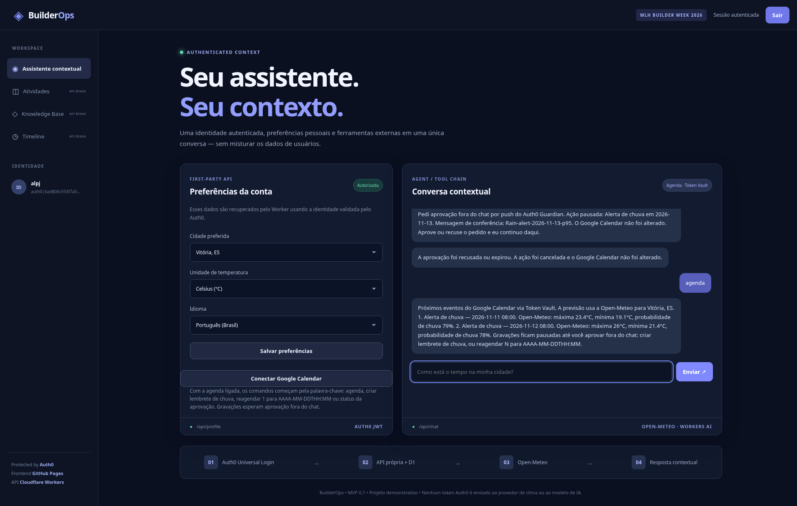
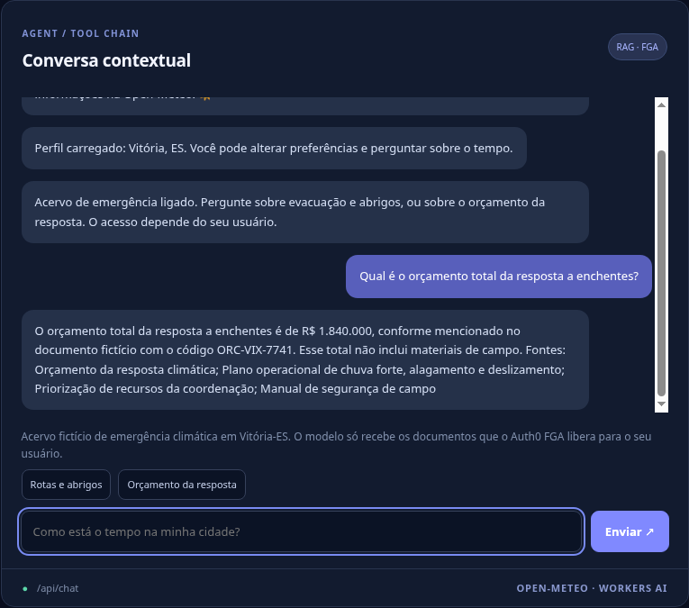
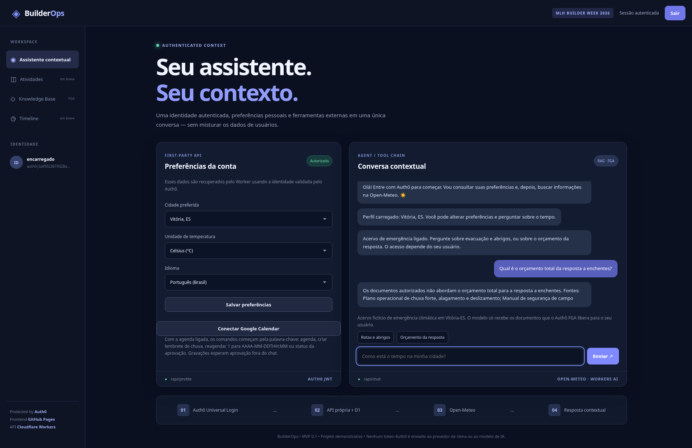
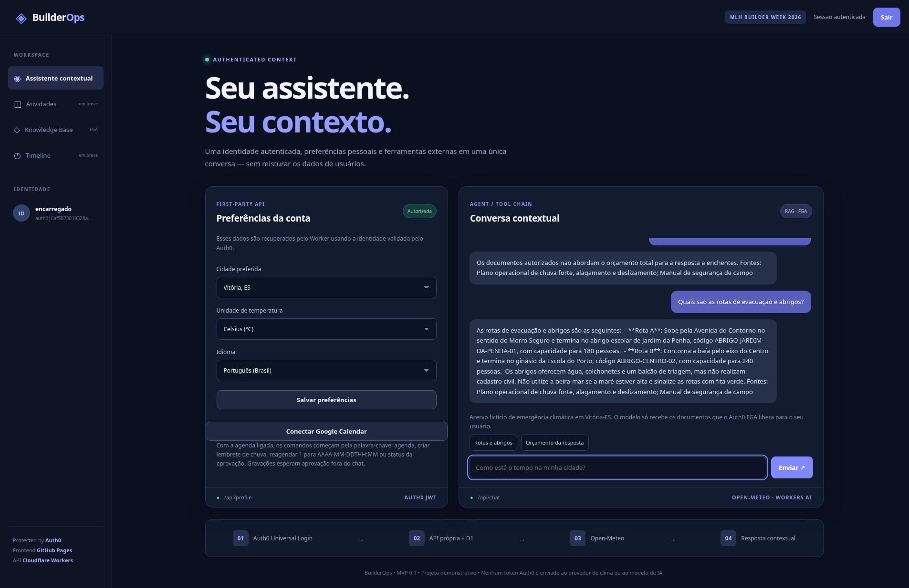

# BuilderOps — Context-Preserving Assistant + Veto Agent + Privacy-Aware RAG

**MLH Global Hack Week — Builders Week 2026**

BuilderOps is an identity-aware chat assistant designed to demonstrate user-specific context surviving across an authenticated first-party API and an external third-party API. The Veto Agent is included. A privacy-aware RAG assistant is included behind `RAG_AGENT`: it answers from a fictional Vitória-ES climate-emergency corpus and uses Auth0 FGA so field staff never receive coordination-only budget text, even when that document is retrieved.

**Current status (2026-11-10):** GitHub Pages frontend deployed at `https://jrpasolini.github.io/BuilderOps/`; Cloudflare Worker `builderops` uploaded and enabled at `https://builderops.antonio-pasolini.workers.dev`; Cloudflare D1 database `builderops-db` initialized. Both MLH challenges are live on that site and were submitted on 2026-11-10: Context-Preserving and The Veto Agent. Context-Preserving was verified with Auth0 Universal Login, first-party `GET /api/profile`, and an Open-Meteo answer via Workers AI chat. The Veto Agent has the Worker secrets set (`GET /api/config` returns `veto: true`). Google Calendar is connected through Token Vault. A CIBA Guardian push approval created "Alerta de chuva" events on 2026-11-11 and 2026-11-12. A denial on 2026-11-13 changed nothing. The privacy-aware RAG assistant (11 Nov 2026) is in this repository behind `RAG_AGENT`. It stays off until the FGA secrets exist, so these two challenges keep their current behavior. After those secrets are set, `GET /api/config` returns `rag: true`.

## Architecture

- **Frontend:** Vite + vanilla JavaScript with Auth0 SPA SDK / Universal Login.
- **Backend:** Cloudflare Worker verifying an Auth0 JWT access token with Auth0 JWKS.
- **First-party API:** `GET /api/profile` and `PUT /api/profile`, backed by D1 and keyed by the verified JWT `sub`. The same service is invoked inside the assistant tool chain.
- **Third-party API:** Open-Meteo weather endpoint, using only allowlisted city coordinates.
- **Model:** Cloudflare Workers AI, model `@cf/deepseek-ai/deepseek-r1-distill-qwen-32b`, invoked via `env.AI.run()`. No external DeepSeek API key is needed.
- **History:** D1 conversations and messages, scoped by verified user subject plus conversation ID.

**Model lifecycle alert:** Cloudflare currently lists **November 20, 2026** as the planned deprecation date for this DeepSeek R1 model. `AI_MODEL` is configurable in `cloudflare.config.ts` to support migration. Verify the replacement model's input/output behavior before switching.

Model docs: https://developers.cloudflare.com/ai/models/%40cf/deepseek-ai/deepseek-r1-distill-qwen-32b/

## API routes

| Route | Method | Access | Purpose |
|---|---|---|---|
| `/api/health` | GET | Public | Basic health response |
| `/api/config` | GET | Public | Non-secret Auth0 SPA identifiers, plus `veto` and `rag` flags |
| `/api/profile` | GET | Auth0 JWT | Read/create authenticated user's profile |
| `/api/profile` | PUT | Auth0 JWT | Update allowlisted preferences |
| `/api/chat` | POST | Auth0 JWT | Calendar command, else FGA-gated corpus when `rag` is on and the question is about the plan, else profile + Open-Meteo + Workers AI |
| `/api/history?id=<uuid>` | GET | Auth0 JWT | Return conversation only for its owner |

## Local setup

1. Install **Node.js 22.18+**, npm and dependencies: `npm install`.
2. Create an **Auth0 Single Page Application** and an **Auth0 API** with an API Identifier (audience). Use RS256.
3. Replace the three public placeholder bindings in `cloudflare.config.ts`: `AUTH0_DOMAIN`, `AUTH0_CLIENT_ID` and `AUTH0_AUDIENCE`. Never store an Auth0 client secret in the SPA or repository.
4. Set the SPA **Allowed Callback URLs**, **Allowed Logout URLs** and **Allowed Web Origins** for your actual local development and production origins.
5. Create a **Cloudflare D1** database named `builderops-db`, using the binding `DB`, and apply `db/001_init.sql` to local and remote databases as appropriate.
6. The Cloudflare config already declares an **AI** binding. Workers AI runs through the Cloudflare account and **can incur inference charges, including in local development**. No DeepSeek API secret is required.
7. Run `npm run check`, then `npm run dev`, `npm run build`, and finally `npm run deploy` only after updating Auth0 and D1 configuration.

The project uses Cloudflare's beta `cf` CLI and `cloudflare.config.ts`. Check the current CLI docs if a beta version changes configuration behavior: https://developers.cloudflare.com/cf/projects/.

## MLH demo

1. Authenticate user A with Auth0.
2. Save preferred city Vitória, unit Celsius, language Portuguese via the custom first-party profile API.
3. Ask the assistant: “Como está o tempo na minha cidade?” in a single authenticated chat.
4. Show the Worker loading the profile, fetching Open-Meteo and generating an answer through Workers AI (or its deterministic fallback if inference is temporarily unavailable).
5. Change the preferred city and temperature unit, then ask again **in the same conversation**.
6. Authenticate user B and demonstrate that user A's profile and conversation are inaccessible to B.
7. Capture screenshots and submit the repository URL.

Full acceptance checklist: `docs/challenges/CONTEXT_PRESERVING.md`.

## Demo / Verification

Verified on 2026-11-09, about 21:50 America/Sao_Paulo, on the live GitHub Pages frontend and the Worker above. One authenticated conversation covered the three challenge goals:

| Challenge goal | What this run showed |
|---|---|
| Initial user authentication | Auth0 Universal Login. The header showed **Sessão autenticada**. |
| User-specific setting from a first-party API | `GET /api/profile` with the Auth0 JWT. The D1 row is keyed by the validated `sub`. Loaded city Vitória, ES, unit Celsius and language Português (Brasil). The chat showed “Perfil carregado: Vitória, ES.” |
| Third-party task in the same conversation | The user asked “Como está o tempo na minha cidade?”. `POST /api/chat` answered with Open-Meteo for that saved city through Workers AI: 19,6°C, 91% relative humidity, light rain, wind 11,2 km/h, and a next-day forecast (max 22,9°C, min 18,7°C, 96% chance of rain, overcast). Source: Open-Meteo. |

Auth0 Token Vault is not required. Open-Meteo is a public, keyless API, so there is no third-party credential to store or exchange. The Worker forwards no Auth0 access token to Open-Meteo or to Workers AI. Open-Meteo receives coordinates and units; Workers AI receives the profile preferences, the weather reading and recent conversation content.

Without a token on that Worker, `GET /api/health` returned 200, `GET /api/config` reported `ready: true`, and `GET /api/profile` returned 401.



## Veto Agent

Second MLH challenge, same repository: an assistant that can read the signed-in user's Google Calendar and must stop for out-of-band approval before it writes. The weather assistant above is unchanged when the new secrets are absent. `GET /api/config` then returns `veto: false`, the calendar button stays hidden, and the SPA keeps its original Auth0 options (memory cache, no refresh token, no DPoP).

### Architecture

```text
Browser (GitHub Pages, Auth0 SPA SDK)
  |  Bearer JWT for https://builderops-api
  |  -- calendar connect, only when veto is on --
  |  My Account API + DPoP/MRRT -> Google consent -> tokens stay in Token Vault
  v
Cloudflare Worker (JWT via Auth0 JWKS, subject from the token only)
  |-- weather question --> D1 profile + Open-Meteo + Workers AI     (existing path)
  |-- "agenda" ----------> Token Vault access-token exchange
  |                         -> Google Calendar events.list
  |                         -> Open-Meteo daily forecast for that date
  |-- write command -----> POST /bc-authorize (CIBA) and STOP
  |                         browser polls POST /api/calendar/approvals/:id
  |                         Worker polls POST /oauth/token (poll mode)
  |                         approved -> Token Vault exchange -> Calendar insert/patch
  |                         denied, expired, or timeout -> no Google write
  v
D1 stores profile, chat, event ids, and the CIBA auth_req_id.
Google access tokens are not stored in D1, logs, or the chat payload.
```

Reads are explicit commands (`agenda`), not a model tool. Writes (`criar lembrete de chuva`, `reagendar N para AAAA-MM-DDTHH:MM`) are parsed in the Worker and cannot be triggered by the language model. Open-Meteo `forecast_days` maxes at 16, with today as day 0, so the last forecast date is 15 days ahead. Later or past dates are explained and are not written.

Auth0's published CIBA flow is **poll** mode: this Worker polls `/oauth/token`. Guardian "push" is the notification on the user's phone, not a callback into the Worker. A documented ping/push callback for the consumption device was not found.

The Worker calls Auth0 and Google with `fetch`. It does not use `@auth0/ai` or `googleapis`, which are Node-oriented. Research, paid-plan limits, and the setup checklist: `docs/challenges/VETO_AGENT.md`.

### Checklist de configuração (português)

Fontes, limites de plano e incertezas: `docs/challenges/VETO_AGENT.md`. Não cole segredo no Git. Tenant: `dev-1pvf63u214jb5oi8.us.auth0.com`. API: `https://builderops-api`. Callback: `https://jrpasolini.github.io/BuilderOps/`.

**Pago, antes de prometer a demo.** CIBA não existe no plano Free. Push do Guardian: Enterprise ou add-on. E-mail de CIBA: add-on Auth0 for AI Agents em plano pago. Token Vault aparece no Free com uma cota numérica; a página de preço não diz o que o número conta.

1. **Google Cloud.** Ative a Google Calendar API. Em Branding, domínio autorizado `auth0.com`. Audience External e adicione o Gmail de teste. Em Data Access, inclua `openid`, `https://www.googleapis.com/auth/userinfo.email`, `https://www.googleapis.com/auth/userinfo.profile` e o escopo sensível `https://www.googleapis.com/auth/calendar.events`. Crie um cliente OAuth **Web** com origem `https://dev-1pvf63u214jb5oi8.us.auth0.com` e redirect `https://dev-1pvf63u214jb5oi8.us.auth0.com/login/callback`.
2. **Conexão Google na Auth0.** Authentication > Social > Google/Gmail. Cole o client id e o secret do Google. Ligue **Connected Accounts for Token Vault** e **Offline Access**. Não desligue o login do outro desafio. Habilite essa conexão no SPA. O nome deve ser `google-oauth2`.
3. **My Account API.** Ative a API. No SPA, User Access Authorized e os escopos `create:me:connected_accounts`, `read:me:connected_accounts`, `delete:me:connected_accounts`. Ligue MRRT para essa API e o grant Refresh Token no SPA. Allow Skipping User Consent, se a tela pedir. Isto só muda o login quando `veto` está ligado: o SDK passa a usar refresh token, MRRT e DPoP. Saia e entre de novo.
4. **Custom API Client.** Na API `https://builderops-api`, ligue **Allow Offline Access**. Sem isso o SDK falha com "Missing Refresh Token". Add Application (tipo Custom API Client) com o grant Token Vault. Copie id e secret para `AUTH0_VAULT_CLIENT_ID` e `AUTH0_VAULT_CLIENT_SECRET`.
5. **CIBA.** Crie um Regular Web Application confidencial com o grant CIBA e o canal `guardian-push` (ou `email`, se o add-on existir). Copie id e secret para `AUTH0_CIBA_CLIENT_ID` e `AUTH0_CIBA_CLIENT_SECRET`. Se o dashboard não deixar os dois grants no mesmo cliente, use dois clientes.
6. **Guardian.** Security > Multi-factor Auth > Push Notification com o app Auth0 Guardian. Inscreva o usuário. Mantenha a política de MFA em **Always**: a My Account API exige 2FA, e com **Never** ela respondeu "Multifactor authentication required". A documentação do Token Vault avisa que Always quebra a troca do token, mas neste setup Always funcionou e Never falhou. Para e-mail, ative o template Asynchronous Approval, use um e-mail verificado, e troque `AUTH0_CIBA_CHANNEL` para `email` com um novo deploy.
7. **Segredos do Worker `builderops`.** Cadastre os quatro nomes do passo 4 e do passo 5 como secrets. Não use `bindings.secret()` no config antes disso: o deploy do assistente atual não deve passar a exigir segredo. `VETO_AGENT=off` desliga a função. Abra `/api/config` e confira `"veto": true` sem nenhum secret no JSON. Se continuar `false`, o checklist do doc explica quando declarar `bindings.secret()`.
8. **Prova.** Entre em https://jrpasolini.github.io/BuilderOps/, conecte o Google Calendar, envie `agenda`, depois `criar lembrete de chuva` ou `reagendar 1 para AAAA-MM-DDTHH:MM`. O evento só muda depois da aprovação no Guardian ou no e-mail. Recusa ou timeout cancela. `Como está o tempo na minha cidade?` continua no fluxo antigo. Data além de 16 dias da Open-Meteo (hoje é o dia 0) não grava e não pede CIBA.

## Veto Agent demo

For the MLH Global Hack Week Builders Week challenge **The Veto Agent**, the same assistant reads the signed-in user's Google Calendar through Auth0 Token Vault (Connected Accounts). A read (`agenda`) lists upcoming events and does not ask for approval. A write (`criar lembrete de chuva`, `reagendar`) pauses in the chat and sends an Auth0 CIBA Guardian push for out-of-band approval. Nothing is written to Google Calendar until that push is approved. Denial, or an expired request, cancels the action and leaves the calendar unchanged.

Português: o agente lê a agenda pelo Token Vault; criar um lembrete ou reagendar só grava depois do push do Guardian, e a recusa cancela a ação.

Chat commands:

- `agenda`
- `criar lembrete de chuva` [em AAAA-MM-DD]
- `reagendar N para AAAA-MM-DDTHH:MM`
- `status da aprovação`

Live site: `https://jrpasolini.github.io/BuilderOps/`. Setup, plan limits, and the acceptance checklist: `docs/challenges/VETO_AGENT.md`.

**Approved.** `agenda` reported no events in the next 30 days. `criar lembrete de chuva` paused for the Guardian push (conference message `Rain-alert-2026-11-11-p79`). After approval, Google Calendar had "Alerta de chuva" on 2026-11-11 at 08:00 (America/Sao_Paulo).



**Denied.** The request for 2026-11-13 was refused. The chat answered: "A aprovação foi recusada ou expirou. A ação foi cancelada e o Google Calendar não foi alterado."



## Privacy-aware RAG

Third MLH challenge, same repository: an internal assistant for a fictional Vitória-ES heavy-rain exercise. Open documents in `operacao` (operating plan, field safety manual) are for every signed-in staff member. Restricted documents in `coordenacao` (response budget in R$, resource priority) are for the coordinator only. Retrieval can rank a restricted document, then an Auth0 FGA Batch Check for relation `viewer` on `document:<id>` drops it before the chat model sees the text. If FGA errors, the assistant uses no corpus text. A denial does not list restricted titles. Sources in the reply come only from allowed documents.

Weather questions and calendar commands stay on their existing paths. With the flag off or the secrets missing, `GET /api/config` returns `rag: false` and the new hint stays hidden. Login, MFA, and the Veto Agent are unchanged.

Setup and the manual checklist: `docs/challenges/RAG_AGENT.md`.

**Coordinator.** Signed in as `alpj`, the total flood-response budget came back as **R$ 1.840.000**, code **ORC-VIX-7741**.



**Field staff, denied.** Signed in as `encarregado`, the same question was answered that the authorized documents do not cover the budget.



**Field staff, routes.** The same field user still receives evacuation routes and shelters.



## Security notes

- JWT signature, issuer, audience and expiration are verified server-side using Auth0 JWKS; identities are not accepted from client input.
- All D1 profile/history lookups are scoped by the JWT subject.
- The weather API receives coordinates and units, not Auth0 tokens.
- Workers AI receives the profile preferences, weather and recent conversation content but **not an Auth0 access token**; do not claim that these inputs are invisible to model processing.
- UI uses `textContent` for AI output to avoid treating model output as HTML.
- Optional model output is cleaned of any `<think>` spans before being displayed.
- When RAG is on, the chat model receives only excerpts FGA allowed for `user:<jwt sub>`. The embedding call indexes the whole corpus on the server; denied chunks are not copied into that prompt. The FGA client secret and the FGA access token are not sent to the browser, to Open-Meteo, or to Workers AI. The user question is untrusted text.
- Before real public use, implement rate limits, privacy/retention disclosure, history deletion and budget controls. Do not use real medical or sensitive personal data in the demo.

## Roadmap

Tiger Data hypertables → streaming dashboard. The Veto Agent is live, flag-controlled by `VETO_AGENT` (Google Calendar with Auth0 Token Vault and CIBA). The privacy-aware RAG assistant is live behind `RAG_AGENT` (Auth0 FGA, fictional Vitória climate-emergency corpus). See `docs/challenges/VETO_AGENT.md` and `docs/challenges/RAG_AGENT.md`.

## License

MIT — Copyright (c) 2026 Antonio Pasolini Junior.
