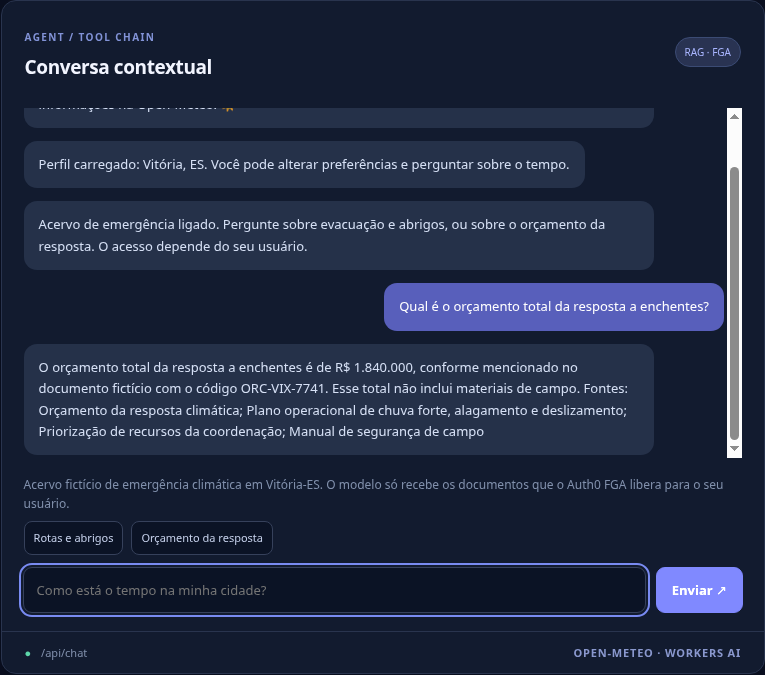
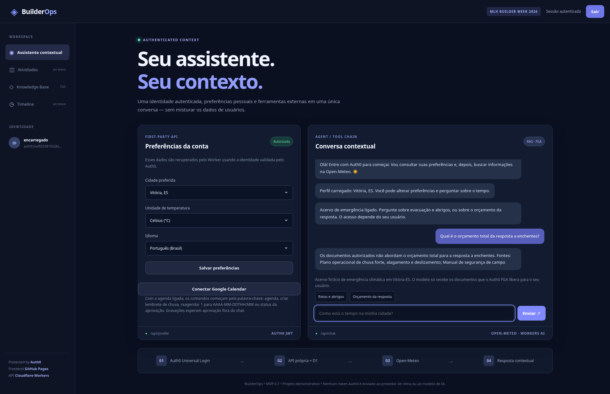
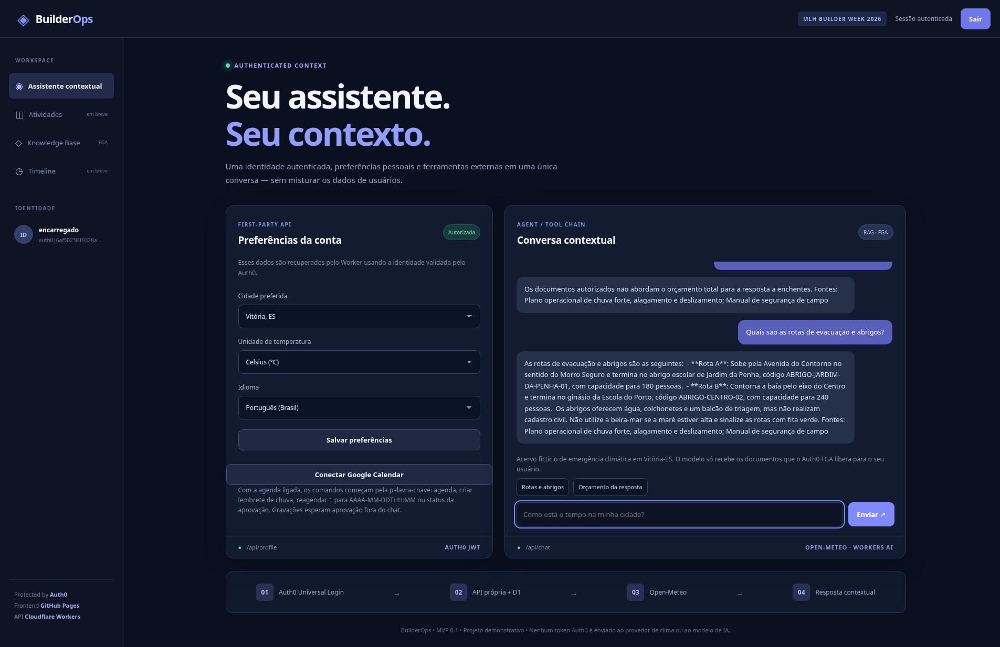

# MLH Builders Week 2026 — The Privacy-Aware RAG Bot

Official challenge: https://www.mlh.com/events/global-hack-week-builders-week/challenges/01a1ad3d-291b-dd4a-ddeb-9b2ef0b791bb

Auth0 FGA document checks, in the same repository as the Context-Preserving Assistant and the Veto Agent.

The weather flow and the calendar flow keep working when the new secrets are absent. Corpus answers run only when `ragConfig()` in `src/rag/fga.js` sees a valid store id, client id and client secret, valid FGA URLs, and `RAG_AGENT` is not `off`. `GET /api/config` then includes `"rag": true` and does not include those secrets.

This phase does not include the owner's FGA dashboard or a second Auth0 user. The end-to-end demo cannot be completed until the checklist below is done by hand. Do not change the Auth0 login settings, the MFA policy, the Veto secrets, or the Veto behavior while doing it.

## What the demo must show

1. A coordinator and a field-staff user both sign in with Auth0. MFA stays **Always**, so the new user enrolls Guardian.
2. Both can ask about the operating plan (routes, shelters, the field manual) and get an answer grounded in those documents.
3. The coordinator can ask about the response budget and see the fictional totals, including **R$ 1.840.000** and the code **ORC-VIX-7741**.
4. Field staff ask the same budget question. The budget document may be retrieved, and FGA still removes it. The answer does not contain the budget figures, the code, or the restricted title.
5. If FGA cannot be reached, the assistant says authorization could not be confirmed and quotes nothing from the corpus.
6. `Como está o tempo na minha cidade?` stays on the Open-Meteo path. `agenda` stays on the Veto Agent path.

## Architecture

```text
GitHub Pages (auth0-spa-js, unchanged login options)
  Bearer access token, audience https://builderops-api
        |
        v
Cloudflare Worker  (jose + Auth0 JWKS, subject from the token only)
  calendar command -> existing Veto path
  plan / budget question, and rag is on
        -> embed the question and the in-repo corpus (Workers AI, first use cached in the isolate)
        -> cosine top-K in the Worker (no Vectorize)
        -> POST https://api.us1.fga.dev/stores/{store}/batch-check
           user = user:<auth0 sub>, relation = viewer, object = document:<id>
        -> only allowed chunks go into the chat model
        -> FGA error: fail closed, no corpus text, no restricted title
  anything else -> existing weather path (D1 profile, Open-Meteo, Workers AI)
```

The Worker speaks HTTP. It does not use LangChain or an FGA SDK.

Token request, client credentials:

- `POST https://auth.fga.dev/oauth/token`
- audience `https://api.us1.fga.dev/`
- the access token is cached in memory until it nears expiry and is never returned to the browser

Public vars already in `cloudflare.config.ts` (change only to point at another FGA region):

| Binding | Default |
|---|---|
| `RAG_AGENT` | `auto` (`off`, `false` or `0` disables the feature) |
| `FGA_API_URL` | `https://api.us1.fga.dev` |
| `FGA_API_AUDIENCE` | `https://api.us1.fga.dev/` |
| `FGA_TOKEN_URL` | `https://auth.fga.dev/oauth/token` |
| `AI_EMBED_MODEL` | `@cf/baai/bge-m3` |

`AI_MODEL` is still the chat model. `<think>` spans are stripped the same way as weather answers.

Secrets, never committed, not declared with `bindings.secret()`:

| Name | Required |
|---|---|
| `FGA_STORE_ID` | yes |
| `FGA_CLIENT_ID` | yes |
| `FGA_CLIENT_SECRET` | yes |
| `FGA_MODEL_ID` | no; when set, Batch Check and the tuple write send it |

A store id or model id must be a 26-character ULID. The client id is 8–128 characters from `A–Z a–z 0–9 _ -`. The client secret must be 16–500 characters. If any check fails, `rag` stays false and questions fall through to weather.

## Corpus

Fictional Portuguese (pt-BR) exercise material for a Vitória-ES heavy-rain scenario. No real personal data. Each file says it is an exercise, not a city plan.

| Document id | Folder | Who can view it |
|---|---|---|
| `plano-operacional` | `operacao` | every authenticated user, via `user:*` |
| `manual-seguranca-campo` | `operacao` | every authenticated user, via `user:*` |
| `orcamento-resposta` | `coordenacao` | coordinator only |
| `priorizacao-recursos` | `coordenacao` | coordinator only |

Source files: `src/rag/docs/`. `npm run corpus:build` rewrites `src/rag/corpus.js`, which is what the Worker bundles. `npm run check` fails if that file drifts from the markdown.

The operating plan includes shelters `ABRIGO-JARDIM-DA-PENHA-01` and `ABRIGO-CENTRO-02`, routes, contact roles and a pre-alert checklist. The field manual is `CAMPO-SEGURO-03`. The budget total is **R$ 1.840.000**, code **ORC-VIX-7741**. The priority note is **PRIORIDADE-COORD-19**.

Embeddings are computed on the first RAG request in a Worker isolate and kept in memory. There is no Vectorize index. Top-K is 12, which is larger than this corpus, so a restricted document is a retrieval candidate and FGA is what hides it. Chunks with cosine similarity of 0 or below are dropped before the check.

Questions route to RAG only after calendar commands are ruled out, and only when the feature is on. The match is accent-insensitive and includes: plano, emergência, enchente, alagamento, deslizamento, abrigo, orçamento, custo, evacuação (and the English words budget, evacuation, shelter, landslide, flood, emergency). A message that starts with `rag:` or `plano:`, or a JSON body `{ "mode": "rag" }`, is explicit. The question and the chat history are untrusted. History entries whose role is not `user` or `assistant` are ignored.

When nothing the user may see was retrieved, the answer is "Nenhum documento autorizado cobre essa pergunta." It does not name the restricted documents. When FGA or the embedding call fails, the answer is "Não foi possível confirmar a autorização dos documentos. Nenhum texto do acervo foi usado."

## Authorization model

Paste `fga/model.fga` into the store. If this page and that file ever differ, use the file.

```fga
model
  schema 1.1

type user

type folder
  relations
    define owner: [user]
    define viewer: [user, user:*] or owner

type document
  relations
    define parent: [folder]
    define viewer: [user, user:*] or viewer from parent
```

User ids in FGA are `user:` plus the Auth0 `user_id`, for example `user:auth0|abc123`. The Worker checks that same string. It never checks `user:*` as if it were a person.

`fga/tuples.example.json` is the seed. `user:*` is viewer of `folder:operacao`. The coordinator is viewer of `folder:coordenacao`. Each document's `parent` is its folder. Viewers of a folder can view its documents. Field staff get no tuple of their own.

## Checklist (português)

Faça nesta ordem. Não cole segredo em arquivo commitado, em issue ou em log. Não mude o aplicativo SPA, os callbacks, a política de MFA nem os segredos do Veto Agent. O tenant deste repositório é `dev-1pvf63u214jb5oi8.us.auth0.com`. O site é `https://jrpasolini.github.io/BuilderOps/`. O Worker é `builderops`.

### 1. Criar o store FGA

1. Abra https://dashboard.fga.dev e entre com a conta Auth0.
2. Crie um store. Um nome claro é `builderops-emergencia`.
3. Em Authorization Model, apague o modelo de exemplo e cole o arquivo `fga/model.fga` por inteiro. Salve.
4. Copie o **Store ID** (26 caracteres). Se a tela mostrar o id do modelo publicado, copie também. Ele é o `FGA_MODEL_ID`, opcional.

### 2. Criar o cliente FGA

1. No mesmo store, abra Clients e crie um cliente. Nome sugerido: `builderops-worker`.
2. Marque permissão de **leitura / consulta** (Check, para o Worker chamar Batch Check).
3. Marque **escrita de tuplas** só se for usar este mesmo cliente para gravar as tuplas no passo 6. O Worker não grava tupla.
4. Copie o Client ID e o Client Secret na hora. O secret não aparece de novo. Não os commite.

### 3. Gravar os segredos no Worker

No Worker `builderops` > **Settings > Variables and Secrets**, crie:

| Nome | Valor |
|---|---|
| `FGA_STORE_ID` | Store ID do passo 1 |
| `FGA_CLIENT_ID` | Client ID do passo 2 |
| `FGA_CLIENT_SECRET` | Client Secret do passo 2 |
| `FGA_MODEL_ID` | opcional; id do modelo, se você copiou |

Pelo terminal, na conta Cloudflare certa, os mesmos nomes:

```bash
npx wrangler secret put FGA_STORE_ID --name builderops
npx wrangler secret put FGA_CLIENT_ID --name builderops
npx wrangler secret put FGA_CLIENT_SECRET --name builderops
npx wrangler secret put FGA_MODEL_ID --name builderops
```

Este repositório não tem `wrangler.toml`. O deploy do dia a dia continua `npm run deploy` (CLI `cf`). O painel da Cloudflare é o mesmo caminho usado no Veto Agent. Não rode `bindings.secret()` no `cloudflare.config.ts` antes dos segredos existirem: o deploy pode falhar e derrubar o assistente que já está no ar.

`RAG_AGENT` já está `auto`. Para desligar sem apagar segredo, mude essa variável para `off` e faça deploy.

Abra `GET https://builderops.antonio-pasolini.workers.dev/api/config`. O JSON deve ter `"rag": true` e **não** pode conter o store id, o client id nem o secret. `"veto"` continua como estava. Se `rag` seguir `false`:

1. Confira os três valores no Worker. O store id tem 26 caracteres. O client id tem 8 a 128 caracteres `A–Z a–z 0–9 _ -`. O secret tem pelo menos 16 caracteres.
2. Só então acrescente em `cloudflare.config.ts`, dentro de `env`:

```ts
FGA_STORE_ID: bindings.secret(),
FGA_CLIENT_ID: bindings.secret(),
FGA_CLIENT_SECRET: bindings.secret(),
```

3. Faça deploy de novo. Inclua `FGA_MODEL_ID: bindings.secret()` na mesma hora só se esse segredo já existir. Se o deploy exigir segredo que ainda não existe, ele pode falhar.

### 4. Segundo usuário Auth0 (equipe de campo)

A política de MFA permanece **Always**. Não troque para Never. O usuário novo precisa concluir o Guardian, senão não entra.

1. Auth0 Dashboard > **User Management > Users > Create User**.
2. Conexão do banco de dados que o site já usa. E-mail e senha de teste. Não use dados de uma pessoa real.
3. Abra o site, entre com esse usuário e inscreva o app Auth0 Guardian quando o QR code aparecer.
4. No painel, abra os dois usuários e copie o **user_id** completo, inclusive o prefixo `auth0|`. O cabeçalho do BuilderOps mostra só o começo; não serve para a tupla.
5. O usuário que já existia, o da demo do Veto, é a coordenação. O usuário novo é a equipe de campo. A equipe de campo **não** ganha tupla. O `user:*` já libera a pasta `operacao`.

### 5. Gravar as tuplas

Na raiz do repositório, com Node 22:

```bash
export COORDINATOR_SUB='auth0|cole-o-user-id-da-coordenacao'
export FGA_STORE_ID='cole-o-store-id'
export FGA_CLIENT_ID='cole-o-client-id'
export FGA_CLIENT_SECRET='cole-o-client-secret'
# opcional, se você criou o segredo:
# export FGA_MODEL_ID='cole-o-model-id'
node scripts/fga-write-tuples.mjs --dry-run
node scripts/fga-write-tuples.mjs
```

O dry-run mostra as tuplas e não mostra o secret. A gravação de verdade é idempotente (`on_duplicate: ignore`). Confira no JSON:

- `user:*` é `viewer` de `folder:operacao`
- `user:` + o sub da coordenação é `viewer` de `folder:coordenacao`
- cada `document:...` tem `parent` na pasta certa

Não crie uma tupla de `folder:coordenacao` para o usuário de campo.

### 6. Prova no site

Pré-condição: `"rag": true` no `/api/config`. Os dois usuários entram. O de campo já passou pelo Guardian.

1. Entre como coordenação. O chat mostra o acervo e dois exemplos.
2. Envie `Quais rotas de evacuação e abrigos usar em um alagamento?`. A resposta cita o plano (abrigo `ABRIGO-JARDIM-DA-PENHA-01` ou o outro abrigo) e a fonte. Não precisa citar o orçamento.
3. Envie `Qual o orçamento e o custo da resposta à enchente?`. A resposta traz os valores fictícios, entre eles **R$ 1.840.000** e o código **ORC-VIX-7741**, e lista o orçamento nas fontes. Tire o screenshot da coordenação.
4. Saia e entre como equipe de campo.
5. Envie a mesma pergunta de abrigos. A resposta ainda pode usar o plano operacional e o manual de campo.
6. Envie a mesma pergunta de orçamento. A resposta **não** mostra R$ 1.840.000, ORC-VIX-7741, PRIORIDADE-COORD-19 nem o título "Orçamento da resposta climática". Pode dizer que nenhum documento autorizado cobre a pergunta, ou responder só com o plano. Tire o screenshot da recusa.
7. Envie `Como está o tempo na minha cidade?`. Continua o fluxo antigo (perfil + Open-Meteo).
8. Se o Veto estiver ligado, envie `agenda`. Continua o fluxo do calendário, sem passar pelo FGA.
9. Os screenshots desta prova estão no README e em `docs/assets/rag-coordinator.png`, `docs/assets/rag-field-denied.png` e `docs/assets/rag-field-routes.png`.

**Coordenação (`alpj`).** O orçamento total da resposta a enchentes volta como **R$ 1.840.000**, código **ORC-VIX-7741**.



**Campo (`encarregado`), orçamento.** A mesma pergunta responde que os documentos autorizados não cobrem o orçamento.



**Campo, rotas.** O mesmo usuário ainda recebe rotas de evacuação e abrigos.



## What is already implemented without dashboard access

- Flag, public config, keyword and explicit routing, in-Worker cosine retrieval, FGA client-credentials and Batch Check, fail-closed errors, source list limited to allowed documents, and the hidden hint until `rag` is true.
- Tests in `tests/rag.test.js` cover: the coordinator's answer contains the budget; field staff's prompt does not, even though Batch Check was asked about that document; both prompts contain the operating plan; an FGA or embedding failure uses no corpus text; weather and calendar routing stay the same with the flag on or off; `/api/config` advertises `rag` without echoing secrets.
- `npm run check` passes without the secrets. `cloudflare.config.ts` does not declare the FGA secrets.

## Uncertainties

- Whether `cf deploy` injects Worker secrets that are not declared with `bindings.secret()`. The recovery snippet is in the checklist. This is the same uncertainty as the Veto Agent.
- Whether the Cloudflare account can run `@cf/baai/bge-m3`. If the first RAG question fail-closes on the embedding call, set `AI_EMBED_MODEL` to another embeddings model the account offers and redeploy. Portuguese quality is better on the multilingual model.
- Whether the FGA dashboard names the client permission "Check" or a broader "query" group. The Worker only calls Batch Check. The seed script also calls Write.
- A live Batch Check against the owner's store was not run here. The tests mock FGA and Workers AI.
